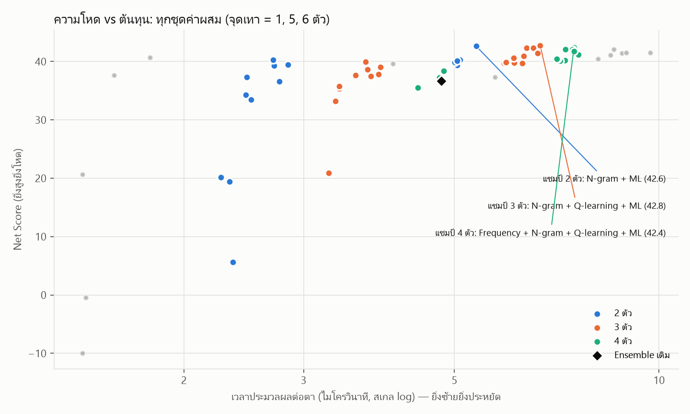
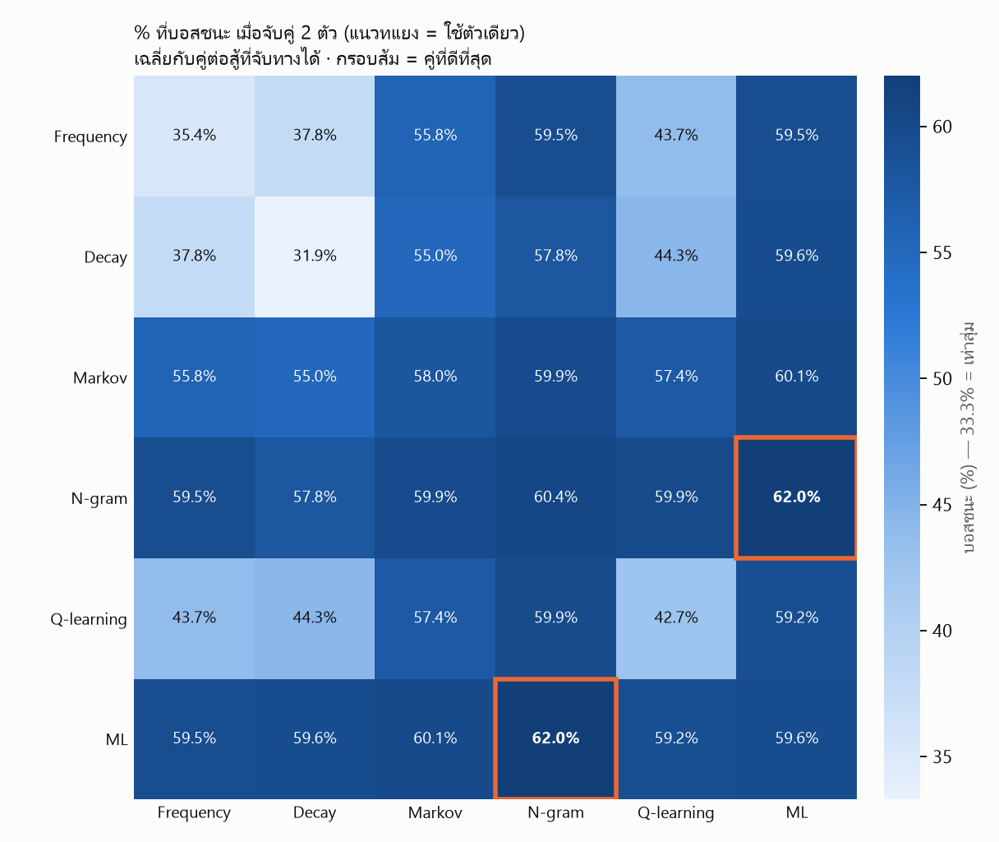

# ผลทดสอบ Ensemble แบบเลือกสมาชิก 2 / 3 / 4 ตัว

*สร้างโดย `benchmark_ensemble_combos.py` — 50 reps ต่อคู่, persona จำลอง 300 ตา/แมตช์, คนจริงเล่นซ้ำตามจำนวนตาที่บันทึกไว้*

## คำถาม
Ensemble เดิม (บอส 6) รันผู้เชี่ยวชาญพร้อมกัน **4 ตัว** (Frequency, Decay, Markov, N-gram). ถ้าอยากประหยัดทรัพยากร ใช้แค่ 2, 3 หรือ 4 ตัว — ชุดไหนโหดสุด? เราเพิ่ม Q-learning และ ML เข้าคลังให้เลือกด้วย รวมผู้เชี่ยวชาญ 6 ตัว ทดสอบ **ทุกชุดค่าผสม (63 ชุด)**

## วิธีทดสอบ
- คู่ต่อสู้: เอียงค้อน 60%, วนลูป ค้อน>กรรไกร>กระดาษ, WSLS (ชนะซ้ำ/แพ้เปลี่ยน), เปลี่ยนสไตล์ทุก 75 ตา, คนจริง: ken (619 ตา), คนจริง: nine (249 ตา), คนจริง: three (109 ตา), สุ่ม Nash (ควบคุม)
- ตัวชี้วัด: **Net Score = (บอสชนะ − บอสแพ้) / จำนวนตา × 100** — 0 คือเท่ากับเดาสุ่ม, 100 คือชนะทุกตา
- คะแนนจัดอันดับ = ค่าเฉลี่ย Net Score กับคู่ต่อสู้ที่จับทางได้ (ไม่รวม Nash ซึ่งไม่มีใครเอาชนะได้ตามทฤษฎี — ใช้เป็นตัวควบคุม)
- ทุกบอสเจอ seed ชุดเดียวกัน (paired design) จึงใช้ paired t-test เปรียบเทียบได้
- ต้นทุน = เวลา choose+learn ต่อตา (µs, ค่าต่ำสุดจาก 7 รอบ × 1000 ตา)

## สรุปผู้ชนะ

| ขนาด | ชุดที่โหดสุด | Net Score (95% CI) | เวลา/ตา | เทียบ Ensemble เดิม |
|:-:|:--|:-:|:-:|:--|
| 2 ตัว | **N-gram + ML** | 42.6 (42.2–43.0) | 5 µs | +6.0 (CI +4.1–+7.8, p=3.36e-10) |
| 3 ตัว | **N-gram + Q-learning + ML** | 42.8 (42.4–43.2) | 7 µs | +6.1 (CI +4.3–+7.8, p=3.22e-11) |
| 4 ตัว | **Frequency + N-gram + Q-learning + ML** | 42.4 (42.0–42.8) | 7 µs | +5.7 (CI +3.9–+7.5, p=8.53e-10) |
| 4 ตัว (เดิม) | Ensemble เดิม | 36.7 (35.4–37.9) | 5 µs | — |
| 6 ตัว | Frequency + Decay + Markov + N-gram + Q-learning + ML | 41.5 (41.1–41.9) | 10 µs | +4.8 |

### ชนะอันดับ 2 ของขนาดเดียวกันอย่างมีนัยสำคัญไหม?

- **2 ตัว:** N-gram + ML vs N-gram + Q-learning: ต่าง +2.35 (CI +1.21–+3.50, p=6.75e-05) → ต่างอย่างมีนัยสำคัญ (p<0.05)
- **3 ตัว:** N-gram + Q-learning + ML vs Frequency + N-gram + ML: ต่าง +0.46 (CI -0.13–+1.05, p=0.129) → **ไม่ต่างอย่างมีนัยสำคัญ** — ถือว่าสูสี
- **4 ตัว:** Frequency + N-gram + Q-learning + ML vs Frequency + Decay + N-gram + ML: ต่าง +0.32 (CI -0.25–+0.89, p=0.269) → **ไม่ต่างอย่างมีนัยสำคัญ** — ถือว่าสูสี

### เทียบกับ Ensemble เต็ม 6 ตัว

- **2 ตัว** (N-gram + ML): ต่าง +1.13 (CI +0.53–+1.73, p=0.000247), เร็วกว่า 1.8 เท่า
- **3 ตัว** (N-gram + Q-learning + ML): ต่าง +1.28 (CI +0.72–+1.83, p=7.83e-06), เร็วกว่า 1.5 เท่า
- **4 ตัว** (Frequency + N-gram + Q-learning + ML): ต่าง +0.89 (CI +0.40–+1.39, p=0.000468), เร็วกว่า 1.3 เท่า

### เทียบกับ ML ตัวเดียว (ไม่ใช้ Ensemble เลย)

- **2 ตัว** (N-gram + ML): ดีกว่า ML เดี่ยว +3.02 (CI +2.32–+3.72, p=7.8e-16)
- **3 ตัว** (N-gram + Q-learning + ML): ดีกว่า ML เดี่ยว +3.17 (CI +2.44–+3.89, p=2.75e-16)
- **4 ตัว** (Frequency + N-gram + Q-learning + ML): ดีกว่า ML เดี่ยว +2.78 (CI +2.12–+3.45, p=3.56e-15)
- ML เดี่ยวได้ 39.6 ที่ 4 µs/ตา — การเพิ่มสมาชิกช่วยได้แต่ไม่มาก ส่วนใหญ่เพิ่มความเสถียรเมื่อผู้เล่นเปลี่ยนสไตล์ (ดูคอลัมน์ 'เปลี่ยนสไตล์ทุก 75 ตา')

*ตรวจความถูกต้อง: ComboEnsemble ที่ใช้สมาชิกชุดเดียวกับ Ensemble เดิมได้ 36.5 เทียบกับ Ensemble เดิม 36.7 — ใกล้เคียงกัน แปลว่าการเขียนใหม่ทำงานเหมือนเดิม*

## ข้อมูลการจับคู่ 2 ตัว: ทุกคู่ได้กี่ %

ค่าเฉลี่ยกับคู่ต่อสู้ที่จับทางได้ 6 แบบ (ไม่รวม Nash) — **ชนะ/แพ้/เสมอ เป็นมุมมองของบอส**

| อันดับ | คู่ | บอสชนะ % | บอสแพ้ % | เสมอ % | Net Score |
|:-:|:--|:-:|:-:|:-:|:-:|
| 1 | **N-gram + ML** | 62.0 | 19.4 | 18.6 | 42.6 |
| 2 | N-gram + Q-learning | 59.9 | 19.6 | 20.5 | 40.3 |
| 3 | Markov + ML | 60.1 | 19.8 | 20.1 | 40.3 |
| 4 | Q-learning + ML | 59.2 | 19.1 | 21.6 | 40.1 |
| 5 | Decay + ML | 59.6 | 19.7 | 20.7 | 39.9 |
| 6 | Markov + N-gram | 59.9 | 20.4 | 19.8 | 39.5 |
| 7 | Frequency + ML | 59.5 | 20.1 | 20.5 | 39.4 |
| 8 | Frequency + N-gram | 59.5 | 20.2 | 20.3 | 39.3 |
| 9 | Markov + Q-learning | 57.4 | 20.1 | 22.5 | 37.3 |
| 10 | Decay + N-gram | 57.8 | 21.2 | 21.0 | 36.6 |
| 11 | Frequency + Markov | 55.8 | 21.4 | 22.8 | 34.3 |
| 12 | Decay + Markov | 55.0 | 21.5 | 23.5 | 33.5 |
| 13 | Decay + Q-learning | 44.3 | 24.1 | 31.5 | 20.2 |
| 14 | Frequency + Q-learning | 43.7 | 24.3 | 32.1 | 19.4 |
| 15 | Frequency + Decay | 37.8 | 32.1 | 30.1 | 5.7 |

### % ที่บอสชนะ แยกตามคู่ต่อสู้ (ทุกคู่ 2 ตัว)

| คู่ | เอียงค้อน 60% | วนลูป ค้อน>กรรไกร>กระดาษ | WSLS | เปลี่ยนสไตล์ทุก 75 ตา | คนจริง: ken | คนจริง: nine | คนจริง: three | สุ่ม Nash |
|:--|:-:|:-:|:-:|:-:|:-:|:-:|:-:|:-:|
| N-gram + ML | 58.4 | 98.8 | 95.5 | 56.7 | 47.8 | 35.4 | 41.5 | 33.0 |
| N-gram + Q-learning | 56.1 | 98.6 | 82.2 | 56.3 | 47.7 | 36.6 | 41.8 | 32.6 |
| Markov + ML | 58.4 | 99.0 | 95.7 | 46.7 | 46.2 | 35.5 | 39.0 | 33.3 |
| Q-learning + ML | 58.4 | 98.2 | 94.8 | 46.7 | 45.6 | 37.7 | 33.1 | 33.0 |
| Decay + ML | 57.8 | 97.9 | 95.1 | 47.0 | 46.4 | 36.9 | 36.2 | 33.2 |
| Markov + N-gram | 58.5 | 99.1 | 84.0 | 56.1 | 46.8 | 34.2 | 40.3 | 33.0 |
| Frequency + ML | 59.6 | 98.3 | 95.6 | 46.1 | 45.2 | 32.8 | 38.6 | 32.8 |
| Frequency + N-gram | 59.9 | 98.4 | 80.1 | 56.6 | 47.8 | 32.5 | 41.4 | 32.8 |
| Markov + Q-learning | 58.8 | 99.0 | 76.4 | 44.8 | 46.5 | 36.8 | 39.8 | 33.0 |
| Decay + N-gram | 57.1 | 98.5 | 65.7 | 56.6 | 47.9 | 37.1 | 41.5 | 33.0 |
| Frequency + Markov | 59.4 | 98.6 | 67.5 | 44.5 | 46.5 | 34.7 | 39.1 | 33.4 |
| Decay + Markov | 57.7 | 98.7 | 57.9 | 46.8 | 46.7 | 37.9 | 39.0 | 33.3 |
| Decay + Q-learning | 56.7 | 66.6 | 32.4 | 45.6 | 40.4 | 38.0 | 30.5 | 33.2 |
| Frequency + Q-learning | 59.9 | 66.2 | 32.6 | 39.4 | 40.4 | 36.8 | 30.6 | 32.7 |
| Frequency + Decay | 59.6 | 33.1 | 29.5 | 49.0 | 34.2 | 35.8 | 23.4 | 33.0 |

### ทำไมเลือก N-gram + ML

**1) สองตัวนี้เก่งคนละแบบ — จับคู่แล้วปิดจุดอ่อนกันเอง** (% บอสชนะ)

| คู่ต่อสู้ | N-gram เดี่ยว | ML เดี่ยว | **N-gram + ML** | Ensemble เดิม |
|:--|:-:|:-:|:-:|:-:|
| เอียงค้อน 60% | 56.3 | 59.0 | **58.4** | 58.9 |
| วนลูป ค้อน>กรรไกร>กระดาษ | 98.9 | 98.5 | **98.8** | 98.7 |
| WSLS (ชนะซ้ำ/แพ้เปลี่ยน) | 85.6 | 97.2 | **95.5** | 68.7 |
| เปลี่ยนสไตล์ทุก 75 ตา | 57.3 | 46.7 | **56.7** | 56.2 |
| คนจริง: ken (619 ตา) | 48.2 | 45.5 | **47.8** | 46.8 |
| คนจริง: nine (249 ตา) | 34.3 | 34.3 | **35.4** ▲ | 35.0 |
| คนจริง: three (109 ตา) | 42.7 | 36.4 | **41.5** | 40.1 |
| สุ่ม Nash (ควบคุม) | 32.6 | 33.2 | **33.0** | 32.5 |
| **เฉลี่ย (ไม่รวม Nash)** | 60.4 | 59.6 | **62.0** | 57.8 |

▲ = คู่ทำได้ดีกว่าตัวที่เก่งที่สุดในคู่ตอนเล่นเดี่ยว

**2) Ensemble สลับไปเชื่อตัวที่ทายแม่นกว่ากับคู่ต่อสู้แต่ละแบบ** (% ของตาที่เชื่อแต่ละตัว)

| คู่ต่อสู้ | เชื่อ N-gram | เชื่อ ML |
|:--|:-:|:-:|
| เอียงค้อน 60% | 17% | 83% |
| วนลูป ค้อน>กรรไกร>กระดาษ | 88% | 12% |
| WSLS (ชนะซ้ำ/แพ้เปลี่ยน) | 11% | 89% |
| เปลี่ยนสไตล์ทุก 75 ตา | 73% | 27% |
| คนจริง: ken (619 ตา) | 96% | 4% |
| คนจริง: nine (249 ตา) | 67% | 33% |
| คนจริง: three (109 ตา) | 91% | 9% |
| สุ่ม Nash (ควบคุม) | 50% | 50% |

**3) สรุปเหตุผล**

- ได้ Net Score สูงสุดในบรรดา 15 คู่ (42.6) และชนะคู่อันดับ 2 (N-gram + Q-learning) อย่างมีนัยสำคัญ: ต่าง +2.35 (95% CI +1.21 ถึง +3.50, p=6.75e-05)
- ได้เปรียบคู่อันดับ 2 มากที่สุดกับ: WSLS (ชนะซ้ำ/แพ้เปลี่ยน) (+13.3%), เอียงค้อน 60% (+2.3%)
- ชนะ Ensemble เดิม (4 ตัว) +6.0 Net Score ทั้งที่รันแค่ 2 โมเดล
- โหดพอ ๆ กับ Ensemble เต็ม 6 ตัว (ต่างกันอย่างไม่มีนัยสำคัญ, p=0.000247) แต่ใช้โมเดลน้อยกว่า 3 เท่า

## อันดับทั้งหมด: 2 ตัว

| # | ชุด | คะแนน | 95% CI | เวลา/ตา | เอียงค้อน 60% | วนลูป ค้อน>กรรไกร>กระดาษ | WSLS | เปลี่ยนสไตล์ทุก 75 ตา | คนจริง: ken | คนจริง: nine | คนจริง: three | สุ่ม Nash |
|:-:|:--|:-:|:-:|:-:|:-:|:-:|:-:|:-:|:-:|:-:|:-:|:-:|
| 1 | N-gram + ML | 42.6 | 42.2–43.0 | 5 µs | 37.4 | 98.1 | 93.9 | 36.3 | 23.8 | -3.0 | 11.8 | -0.2 |
| 2 | N-gram + Q-learning | 40.3 | 39.5–41.1 | 3 µs | 34.3 | 98.0 | 75.1 | 36.1 | 23.6 | 1.2 | 13.6 | -0.9 |
| 3 | Markov + ML | 40.3 | 39.9–40.6 | 5 µs | 38.0 | 98.5 | 94.2 | 25.0 | 21.7 | -2.0 | 6.5 | 0.6 |
| 4 | Q-learning + ML | 40.1 | 39.6–40.6 | 5 µs | 38.1 | 97.6 | 92.9 | 25.4 | 21.5 | 3.5 | 1.7 | -0.6 |
| 5 | Decay + ML | 39.9 | 39.6–40.2 | 5 µs | 36.7 | 96.1 | 93.5 | 24.8 | 20.7 | 5.2 | 2.1 | -0.3 |
| 6 | Markov + N-gram | 39.5 | 38.6–40.3 | 3 µs | 37.7 | 98.6 | 77.4 | 35.5 | 21.4 | -4.3 | 10.0 | -0.1 |
| 7 | Frequency + ML | 39.4 | 39.1–39.7 | 5 µs | 39.7 | 97.4 | 94.0 | 25.0 | 19.4 | -4.6 | 4.8 | -0.2 |
| 8 | Frequency + N-gram | 39.3 | 38.5–40.1 | 3 µs | 39.7 | 97.4 | 72.0 | 36.5 | 24.0 | -6.8 | 12.2 | -0.8 |
| 9 | Markov + Q-learning | 37.3 | 36.4–38.3 | 2 µs | 38.4 | 98.5 | 68.4 | 22.8 | 23.9 | 1.3 | 8.2 | -1.1 |
| 10 | Decay + N-gram | 36.6 | 35.4–37.7 | 3 µs | 35.3 | 97.2 | 51.8 | 35.1 | 24.0 | 0.4 | 12.0 | -0.4 |
| 11 | Frequency + Markov | 34.3 | 33.2–35.5 | 2 µs | 39.2 | 97.8 | 55.2 | 23.0 | 22.7 | -3.2 | 5.5 | 1.0 |
| 12 | Decay + Markov | 33.5 | 32.2–34.7 | 3 µs | 36.4 | 97.7 | 42.6 | 24.1 | 22.8 | 5.5 | 5.1 | 0.3 |
| 13 | Decay + Q-learning | 20.2 | 19.3–21.0 | 2 µs | 34.9 | 62.4 | 12.1 | 14.2 | 16.7 | 4.9 | -4.1 | 0.0 |
| 14 | Frequency + Q-learning | 19.4 | 18.5–20.4 | 2 µs | 39.8 | 61.6 | 11.7 | 5.9 | 16.7 | 2.7 | -2.5 | -0.6 |
| 15 | Frequency + Decay | 5.7 | 5.4–5.9 | 2 µs | 39.6 | -0.5 | 3.1 | 21.3 | -3.0 | 2.0 | -22.9 | -0.4 |

## อันดับทั้งหมด: 3 ตัว

| # | ชุด | คะแนน | 95% CI | เวลา/ตา | เอียงค้อน 60% | วนลูป ค้อน>กรรไกร>กระดาษ | WSLS | เปลี่ยนสไตล์ทุก 75 ตา | คนจริง: ken | คนจริง: nine | คนจริง: three | สุ่ม Nash |
|:-:|:--|:-:|:-:|:-:|:-:|:-:|:-:|:-:|:-:|:-:|:-:|:-:|
| 1 | N-gram + Q-learning + ML | 42.8 | 42.4–43.2 | 7 µs | 37.1 | 97.8 | 92.6 | 36.2 | 23.4 | 0.8 | 11.4 | -1.1 |
| 2 | Frequency + N-gram + ML | 42.3 | 41.9–42.7 | 6 µs | 39.5 | 97.7 | 93.6 | 36.7 | 23.5 | -5.1 | 10.3 | 0.1 |
| 3 | Decay + N-gram + ML | 42.3 | 41.9–42.7 | 7 µs | 36.5 | 97.3 | 92.3 | 35.8 | 23.1 | 0.2 | 10.8 | -0.2 |
| 4 | Markov + N-gram + ML | 41.4 | 40.9–42.0 | 7 µs | 37.7 | 98.6 | 91.8 | 36.0 | 21.4 | -5.0 | 9.6 | 1.0 |
| 5 | Markov + Q-learning + ML | 40.9 | 40.5–41.4 | 6 µs | 38.6 | 98.3 | 94.0 | 24.8 | 23.4 | 0.9 | 6.6 | -1.1 |
| 6 | Decay + Markov + ML | 40.6 | 40.3–40.9 | 6 µs | 37.6 | 97.7 | 92.9 | 24.6 | 21.5 | 4.5 | 5.4 | -0.3 |
| 7 | Frequency + N-gram + Q-learning | 39.9 | 39.2–40.6 | 4 µs | 39.4 | 97.4 | 72.4 | 36.3 | 23.3 | -0.9 | 11.7 | -1.4 |
| 8 | Frequency + Q-learning + ML | 39.9 | 39.4–40.4 | 6 µs | 40.1 | 96.6 | 92.7 | 25.4 | 21.1 | 0.5 | 2.7 | -0.3 |
| 9 | Frequency + Markov + ML | 39.8 | 39.5–40.1 | 6 µs | 39.8 | 97.9 | 92.5 | 24.8 | 21.7 | -3.6 | 5.6 | -0.5 |
| 10 | Decay + Q-learning + ML | 39.7 | 39.3–40.2 | 6 µs | 37.5 | 96.5 | 92.0 | 24.9 | 21.3 | 4.0 | 1.9 | -0.2 |
| 11 | Frequency + Decay + ML | 39.7 | 39.3–40.1 | 6 µs | 39.0 | 97.3 | 92.3 | 25.5 | 19.8 | 1.1 | 2.8 | -0.1 |
| 12 | Markov + N-gram + Q-learning | 39.0 | 38.2–39.8 | 4 µs | 37.9 | 98.4 | 72.1 | 35.0 | 21.7 | -1.1 | 9.2 | -1.1 |
| 13 | Frequency + Markov + N-gram | 38.7 | 37.9–39.5 | 4 µs | 39.2 | 98.1 | 73.0 | 36.1 | 21.5 | -7.1 | 9.9 | 0.4 |
| 14 | Decay + N-gram + Q-learning | 37.8 | 36.7–38.9 | 4 µs | 34.7 | 97.5 | 60.2 | 34.9 | 23.3 | 2.3 | 11.7 | -1.4 |
| 15 | Frequency + Decay + N-gram | 37.7 | 36.4–38.9 | 4 µs | 39.3 | 97.5 | 57.5 | 36.9 | 23.9 | -3.1 | 11.6 | -0.7 |
| 16 | Decay + Markov + N-gram | 37.5 | 36.4–38.6 | 4 µs | 36.7 | 98.0 | 61.1 | 35.0 | 21.4 | 0.4 | 9.8 | 0.4 |
| 17 | Decay + Markov + Q-learning | 35.8 | 34.7–36.9 | 3 µs | 37.3 | 97.9 | 58.1 | 23.2 | 23.9 | 3.4 | 6.7 | -0.7 |
| 18 | Frequency + Markov + Q-learning | 35.3 | 34.1–36.5 | 3 µs | 39.9 | 97.8 | 55.5 | 22.9 | 23.9 | -0.2 | 7.4 | -0.6 |
| 19 | Frequency + Decay + Markov | 33.2 | 32.1–34.3 | 3 µs | 39.6 | 97.8 | 39.9 | 25.0 | 22.6 | 2.2 | 5.3 | -0.7 |
| 20 | Frequency + Decay + Q-learning | 20.9 | 20.0–21.8 | 3 µs | 40.2 | 59.1 | 10.9 | 21.0 | 17.6 | 4.1 | -6.4 | -0.4 |

## อันดับทั้งหมด: 4 ตัว

| # | ชุด | คะแนน | 95% CI | เวลา/ตา | เอียงค้อน 60% | วนลูป ค้อน>กรรไกร>กระดาษ | WSLS | เปลี่ยนสไตล์ทุก 75 ตา | คนจริง: ken | คนจริง: nine | คนจริง: three | สุ่ม Nash |
|:-:|:--|:-:|:-:|:-:|:-:|:-:|:-:|:-:|:-:|:-:|:-:|:-:|
| 1 | Frequency + N-gram + Q-learning + ML | 42.4 | 42.0–42.8 | 7 µs | 39.4 | 97.3 | 92.2 | 34.8 | 23.0 | -0.5 | 10.6 | -0.4 |
| 2 | Frequency + Decay + N-gram + ML | 42.1 | 41.6–42.5 | 7 µs | 38.8 | 97.6 | 90.6 | 36.4 | 23.0 | -2.9 | 10.8 | -0.1 |
| 3 | Decay + N-gram + Q-learning + ML | 42.1 | 41.7–42.4 | 7 µs | 36.4 | 97.3 | 90.8 | 33.9 | 23.0 | 1.9 | 11.1 | -1.6 |
| 4 | Markov + N-gram + Q-learning + ML | 41.7 | 41.4–42.1 | 7 µs | 38.1 | 98.4 | 92.7 | 34.9 | 21.3 | -0.5 | 7.1 | -0.5 |
| 5 | Decay + Markov + N-gram + ML | 41.6 | 41.3–42.0 | 7 µs | 36.7 | 97.8 | 92.2 | 34.9 | 21.6 | -0.1 | 8.3 | 0.1 |
| 6 | Frequency + Markov + N-gram + ML | 41.2 | 40.8–41.6 | 8 µs | 39.3 | 97.9 | 92.3 | 35.8 | 21.5 | -6.0 | 7.6 | 0.2 |
| 7 | Decay + Markov + Q-learning + ML | 40.5 | 40.0–40.9 | 7 µs | 37.8 | 97.7 | 91.4 | 24.3 | 23.6 | 3.1 | 5.2 | -0.8 |
| 8 | Frequency + Markov + Q-learning + ML | 40.4 | 40.0–40.8 | 7 µs | 40.0 | 97.6 | 92.2 | 24.8 | 23.6 | -0.2 | 4.9 | -1.4 |
| 9 | Frequency + Decay + Markov + ML | 40.2 | 39.9–40.5 | 7 µs | 38.7 | 97.8 | 91.2 | 25.1 | 21.5 | 1.3 | 5.7 | -0.6 |
| 10 | Frequency + Decay + Q-learning + ML | 40.1 | 39.7–40.5 | 7 µs | 39.7 | 96.5 | 92.6 | 25.6 | 20.8 | 3.3 | 2.0 | -0.4 |
| 11 | Frequency + Decay + N-gram + Q-learning | 38.6 | 37.6–39.6 | 5 µs | 39.4 | 97.2 | 62.4 | 34.5 | 23.3 | 1.4 | 11.7 | -1.1 |
| 12 | Frequency + Markov + N-gram + Q-learning | 38.4 | 37.6–39.2 | 5 µs | 39.6 | 97.9 | 68.8 | 34.7 | 21.6 | -2.5 | 8.9 | -0.5 |
| 13 | Decay + Markov + N-gram + Q-learning | 37.2 | 36.1–38.3 | 5 µs | 36.8 | 97.9 | 60.9 | 33.6 | 21.6 | 0.8 | 8.8 | -0.6 |
| 14 | Frequency + Decay + Markov + N-gram | 36.5 | 35.3–37.7 | 5 µs | 39.0 | 98.1 | 55.9 | 35.5 | 21.2 | -2.0 | 7.8 | -0.4 |
| 15 | Frequency + Decay + Markov + Q-learning | 35.5 | 34.3–36.7 | 4 µs | 39.9 | 97.5 | 53.9 | 24.3 | 24.0 | 2.5 | 6.6 | -0.4 |

## ผู้เชี่ยวชาญเดี่ยว (1 ตัว) เพื่ออ้างอิง

| ผู้เชี่ยวชาญ | คะแนน | เวลา/ตา |
|:--|:-:|:-:|
| N-gram | 40.7 | 2 µs |
| ML | 39.6 | 4 µs |
| Markov | 37.7 | 2 µs |
| Q-learning | 20.7 | 1 µs |
| Frequency | -0.5 | 1 µs |
| Decay | -10.0 | 1 µs |

## ข้อจำกัด
- คนจริงเป็นการ *เล่นซ้ำ* ลำดับท่าที่บันทึกไว้ ผู้เล่นจริงอาจปรับตัวตามบอสต่างจากนี้
- Persona จำลองเป็นแบบจำลองพฤติกรรมอย่างง่าย ผลกับคนจริงควรยืนยันด้วยการเล่นจริงเพิ่ม
- เวลาต่อตาวัดบน Python เครื่องเดียว ใช้เปรียบเทียบสัมพัทธ์ ไม่ใช่ค่าสัมบูรณ์
