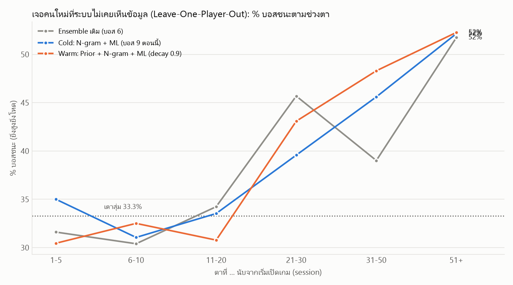

# ใช้ได้กับทุกคนไหม? — Warm start ด้วย Population Prior (Leave-One-Player-Out)

*สร้างโดย `benchmark_warm_start.py` — 50 reps, บอสเริ่มใหม่ทุก session*

## สรุป

- **บอส 9 ตอนนี้ (Cold: N-gram + ML) ชนะเกินสุ่มกับคนที่ระบบไม่เคยเห็นข้อมูลอยู่แล้ว:** 46.3% (สุ่ม = 33.3%) เพราะเรียนรู้จากคนตรงหน้าระหว่างเกม — แต่ 10 ตาแรกยังได้แค่ 33.2%
- **Population Prior อย่างเดียวได้ 33.6% ≈ สุ่ม** → นิสัยของผู้เล่นที่มีอยู่ยังใช้ทายคนอื่นไม่ได้ (ผู้เล่นแต่ละคนนิสัยต่างกันมาก และมีข้อมูลคนจริงน้อยเกินไป)
- **Warm start (Prior + N-gram + ML, decay 0.9) vs Cold:** ตา 1-10 ต่าง -0.5% (p=0.58), ทั้ง session ต่าง +2.2% (p=0.86) → **ยังไม่ต่างอย่างมีนัยสำคัญ** (ไม่แย่ลง แต่ยังพิสูจน์ไม่ได้ว่าดีขึ้น)
- Prior ช่วยมากกับผู้เล่นแบบ ชนะซ้ำ/แพ้เปลี่ยน (WSLS) ตั้งแต่ตาแรก (ดูตาราง persona) แต่เสียเล็กน้อยช่วงต้นกับผู้เล่นแบบอื่น
- **ทางที่จะทำให้ Warm start ได้ผลจริง = เก็บข้อมูลคนจริงเพิ่ม** แล้วรัน `python benchmark_warm_start.py` ใหม่ (สคริปต์จะเทรน/ทดสอบใหม่และเขียนสรุปนี้ใหม่อัตโนมัติ)

## แนวคิด
- บอสที่เรียนระหว่างเกมเริ่มจากศูนย์ทุกครั้ง → **ช่วงต้นเกมยังไม่รู้จักคนตรงหน้า**
- **Population Prior** = ตารางนิสัยรวมของผู้เล่นจริงทุกคน: ท่าแรก, ท่าถัดไปหลังท่าเดิม, ท่าถัดไปหลัง (ท่าเดิม + ชนะ/แพ้/เสมอ) แล้วออกท่าที่ได้ผลตอบแทนคาดหวังสูงสุด
- ใส่ Prior เป็นสมาชิกตัวที่ 3 ของ Lite Ensemble: ต้นเกมเชื่อ Prior → เมื่อ N-gram/ML เรียนรู้คนตรงหน้าแล้วแม่นกว่า Ensemble จะเปลี่ยนไปเชื่อเอง (decay 0.9 = ลืมคะแนนเก่า ให้เปลี่ยนใจได้เร็ว)

## วิธีทดสอบที่ไม่โกง: Leave-One-Player-Out
- ทดสอบกับผู้เล่น X โดยเทรน Prior จาก **ทุกคนยกเว้น X** = จำลองการเจอ "คนใหม่ที่ระบบไม่เคยเห็น"
- บอสเริ่มใหม่ทุก session (เหมือนเปิดเกมใหม่) แล้วเล่นซ้ำลำดับท่าจริงของ X
- ข้อมูลจำลอง (Guest) ไม่ถูกใช้ทั้งเทรนและทดสอบ

| ผู้เล่นที่ทดสอบ | จำนวนตา / session | Prior เทรนจาก |
|:--|:-:|:--|
| ken | 617 / 9 | nine, three (358 ตา) |
| nine | 249 / 2 | ken, three (728 ตา) |
| three | 109 / 3 | ken, nine (868 ตา) |

## ผล: % ที่บอสชนะ (รวมทุกผู้เล่นที่ทดสอบ)

| บอส | ตา 1-10 | ตา 11-30 | ตา 31+ | ทั้งหมด |
|:--|:-:|:-:|:-:|:-:|
| Cold: N-gram + ML (บอส 9 ตอนนี้) | 33.2 | 36.3 | 50.8 | 46.3 |
| Population Prior อย่างเดียว | 31.2 | 36.1 | 33.5 | 33.6 |
| Warm: Prior + N-gram + ML | 31.8 | 37.2 | 51.5 | 46.8 |
| Warm: Prior + N-gram + ML (decay 0.9) | 31.4 | 36.3 | 51.5 | 46.6 |
| Cold: N-gram + ML (decay 0.9) | 33.5 | 36.2 | 51.3 | 46.7 |
| Ensemble เดิม (บอส 6) | 31.1 | 39.4 | 49.2 | 45.4 |

*33.3% = เท่ากับเดาสุ่ม*

### ผู้เล่น: ken

| บอส | ตา 1-10 | ตา 11-30 | ตา 31+ | ทั้งหมด |
|:--|:-:|:-:|:-:|:-:|
| Cold: N-gram + ML (บอส 9 ตอนนี้) | 34.5 | 43.2 | 56.2 | 51.2 |
| Population Prior อย่างเดียว | 30.6 | 35.8 | 32.0 | 32.4 |
| Warm: Prior + N-gram + ML | 31.2 | 43.1 | 55.7 | 50.4 |
| Warm: Prior + N-gram + ML (decay 0.9) | 31.4 | 42.2 | 55.9 | 50.5 |
| Cold: N-gram + ML (decay 0.9) | 34.9 | 43.1 | 57.4 | 52.1 |
| Ensemble เดิม (บอส 6) | 29.8 | 46.7 | 55.4 | 50.6 |

### ผู้เล่น: nine

| บอส | ตา 1-10 | ตา 11-30 | ตา 31+ | ทั้งหมด |
|:--|:-:|:-:|:-:|:-:|
| Cold: N-gram + ML (บอส 9 ตอนนี้) | 31.1 | 23.7 | 41.7 | 37.9 |
| Population Prior อย่างเดียว | 35.0 | 40.0 | 36.5 | 36.9 |
| Warm: Prior + N-gram + ML | 35.2 | 24.9 | 45.1 | 41.1 |
| Warm: Prior + N-gram + ML (decay 0.9) | 30.7 | 24.9 | 45.0 | 40.6 |
| Cold: N-gram + ML (decay 0.9) | 30.9 | 23.2 | 41.1 | 37.4 |
| Ensemble เดิม (บอส 6) | 40.3 | 23.4 | 38.6 | 36.3 |

### ผู้เล่น: three

| บอส | ตา 1-10 | ตา 11-30 | ตา 31+ | ทั้งหมด |
|:--|:-:|:-:|:-:|:-:|
| Cold: N-gram + ML (บอส 9 ตอนนี้) | 29.4 | 28.2 | 42.3 | 37.7 |
| Population Prior อย่างเดียว | 29.4 | 30.0 | 34.7 | 33.0 |
| Warm: Prior + N-gram + ML | 30.6 | 34.1 | 42.4 | 39.0 |
| Warm: Prior + N-gram + ML (decay 0.9) | 32.4 | 31.6 | 41.4 | 38.2 |
| Cold: N-gram + ML (decay 0.9) | 29.4 | 29.3 | 40.9 | 37.0 |
| Ensemble เดิม (บอส 6) | 26.4 | 36.5 | 39.2 | 36.7 |

## ทดสอบนัยสำคัญ (หน่วย = session ของคนจริง, Wilcoxon signed-rank)

| เปรียบเทียบ | ช่วง | ต่างเฉลี่ย (%) | session ที่ดีขึ้น / แย่ลง | p |
|:--|:--|:-:|:-:|:-:|
| Warm: Prior + N-gram + ML (decay 0.9) vs Cold: N-gram + ML (บอส 9 ตอนนี้) | ตา 1-10 | -0.5 | 5 / 9 (จาก 14) | 0.583 |
| Warm: Prior + N-gram + ML (decay 0.9) vs Cold: N-gram + ML (บอส 9 ตอนนี้) | ทั้ง session | +2.2 | 5 / 9 (จาก 14) | 0.855 |
| Warm: Prior + N-gram + ML vs Cold: N-gram + ML (บอส 9 ตอนนี้) | ตา 1-10 | -0.4 | 5 / 9 (จาก 14) | 0.615 |
| Warm: Prior + N-gram + ML vs Cold: N-gram + ML (บอส 9 ตอนนี้) | ทั้ง session | +2.0 | 7 / 7 (จาก 14) | 0.761 |
| Warm: Prior + N-gram + ML (decay 0.9) vs Ensemble เดิม (บอส 6) | ตา 1-10 | +1.2 | 7 / 7 (จาก 14) | 0.851 |
| Warm: Prior + N-gram + ML (decay 0.9) vs Ensemble เดิม (บอส 6) | ทั้ง session | +3.8 | 8 / 5 (จาก 14) | 0.173 |

## ตรวจความปลอดภัย: Prior ไม่ทำให้แย่ลงกับผู้เล่นแบบอื่น (persona จำลอง)

*Prior เทรนจากผู้เล่นจริงทุกคน, 150 ตา/แมตช์ — ตัวเลข = % บอสชนะ (ตา 1-10 / ทั้งเกม)*

| บอส | เอียงค้อน 60% | วนลูป | WSLS | เปลี่ยนสไตล์ทุก 75 ตา | สุ่ม Nash |
|:--|:-:|:-:|:-:|:-:|:-:|
| Cold: N-gram + ML (บอส 9 ตอนนี้) | 44 / 57.1 | 65 / 97.7 | 42 / 91.1 | 51 / 73.2 | 33 / 32.7 |
| Population Prior อย่างเดียว | 41 / 39.4 | 40 / 33.3 | 85 / 99.0 | 44 / 37.3 | 34 / 33.5 |
| Warm: Prior + N-gram + ML | 43 / 55.7 | 59 / 97.3 | 75 / 97.7 | 49 / 71.9 | 34 / 32.7 |
| Warm: Prior + N-gram + ML (decay 0.9) | 41 / 55.8 | 62 / 97.5 | 74 / 97.4 | 51 / 74.7 | 35 / 33.2 |
| Cold: N-gram + ML (decay 0.9) | 45 / 57.4 | 64 / 97.6 | 44 / 91.4 | 52 / 75.4 | 34 / 32.5 |
| Ensemble เดิม (บอส 6) | 47 / 58.5 | 62 / 97.5 | 33 / 54.8 | 61 / 72.5 | 35 / 32.6 |

## ข้อจำกัด (ต้องพูดตอนพรีเซนต์)
- มีผู้เล่นจริงแค่ **3 คน** — ผลบอกแนวโน้ม แต่ยังสรุปว่า "ใช้ได้กับทุกคน" ไม่ได้ ควรเก็บเพิ่ม 5-10 คน คนละ 100+ ตา แล้วรันสคริปต์นี้ใหม่
- การเล่นซ้ำ (replay) ใช้ลำดับท่าที่ผู้เล่นออกตอนสู้บอสตัวเก่า ผู้เล่นจริงอาจตอบสนองต่างไปเมื่อเจอบอสใหม่
- ค่า decay 0.9 เลือกจากข้อมูลชุดเดียวกันนี้ (มีตัวเลือกแค่ 2 ค่า) จึงอาจดูดีเกินจริงเล็กน้อย
- ไม่มีบอสไหนชนะเกิน 33.3% ได้กับคนที่ออกสุ่มจริง (Nash) — คำกล่าวที่ถูกคือ "ชนะเกินสุ่มกับผู้เล่นทั่วไป"
